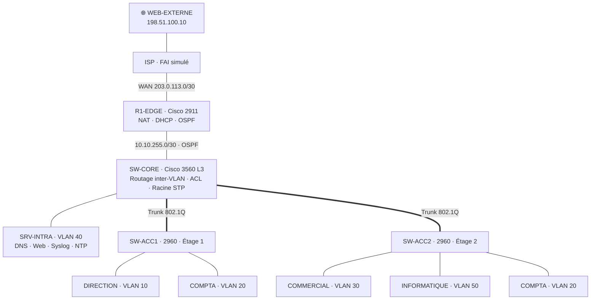

# Réseau segmenté et sécurisé d'une PME : VLANs, routage inter-VLAN et OSPF


Conception, configuration et validation du réseau d'une PME fictive (**Arvex**, 40 salariés, 2 étages) dans Cisco Packet Tracer. Le réseau existant, « à plat » et sans sécurité, est refondu en un réseau **segmenté par service**, avec un routage inter-VLAN filtré, un accès Internet par NAT, des services centralisés (DHCP, DNS, Syslog, NTP) et une **sécurisation complète de l'administration et des ports d'accès**.

Chaque choix est justifié, et le fonctionnement est validé par un **cahier de recette de 30 tests**.

---

## Sommaire

- [Topologie](#topologie)
- [Ce que fait le réseau](#ce-que-fait-le-réseau)
- [Plan d'adressage](#plan-dadressage)
- [Ouvrir et tester la maquette](#ouvrir-et-tester-la-maquette)
- [Résultats de la recette](#résultats-de-la-recette)
- [Écarts constatés](#écarts-constatés)
- [Outils utilisés](#outils-utilisés)
- [Documentation](#documentation)
- [Structure du dépôt](#structure-du-dépôt)
- [Compétences mises en œuvre](#compétences-mises-en-œuvre)
- [Pistes d'amélioration](#pistes-damélioration)

---

## Topologie

<!-- Remplacez ce schéma par une capture de votre maquette :  -->



**Matériel :** 1 routeur Cisco 2911, 1 switch de niveau 3 Cisco 3560, 2 switches Cisco 2960, 1 serveur, 6 postes (+ un FAI et un site web simulés).

## Ce que fait le réseau

**Segmentation et routage**
- 5 VLANs métier + 1 VLAN d'administration, dont la COMPTA répartie sur **deux étages** (trunks 802.1Q)
- Routage inter-VLAN par **SVI** sur le switch de niveau 3
- **OSPF** entre le cœur et le routeur, avec diffusion de la route par défaut
- Accès Internet par **NAT/PAT** avec une seule adresse publique

**Services**
- **DHCP** centralisé sur le routeur, avec **relais** (`ip helper-address`)
- **DNS** et intranet internes
- Journaux centralisés (**Syslog**) et heure synchronisée (**NTP**)

**Sécurité**
- **ACL étendues** : le Commercial n'accède pas à la Comptabilité, seul le service Informatique accède au réseau d'administration, et chaque VLAN est protégé contre l'usurpation d'adresse
- Administration en **SSH v2** uniquement, limitée au VLAN Informatique (`access-class`)
- Protections de niveau 2 : **Port Security**, **DHCP Snooping**, **BPDU Guard**, VLAN natif dédié, DTP désactivé, ports inutilisés coupés
- **Rapid PVST+** avec pont racine maîtrisé
- Filtrage anti-usurpation côté Internet

Le détail et la justification de chaque mesure sont dans [docs/05-securite.md](docs/05-securite.md).

## Plan d'adressage

| VLAN | Nom | Réseau | Passerelle | Attribution |
|------|-----|--------|------------|-------------|
| 10 | DIRECTION | 10.10.10.0/24 | 10.10.10.1 | DHCP |
| 20 | COMPTA | 10.10.20.0/24 | 10.10.20.1 | DHCP |
| 30 | COMMERCIAL | 10.10.30.0/24 | 10.10.30.1 | DHCP |
| 40 | SERVEURS | 10.10.40.0/24 | 10.10.40.1 | Fixe |
| 50 | INFORMATIQUE | 10.10.50.0/24 | 10.10.50.1 | DHCP |
| 99 | ADMIN | 10.10.99.0/24 | 10.10.99.1 | Fixe |
| 998 / 999 | PARKING / NATIVE | — | — | — |

Plan complet, brassage des ports et matrice des flux : [docs/03-plan-adressage.md](docs/03-plan-adressage.md).

## Ouvrir et tester la maquette

**Prérequis :** [Cisco Packet Tracer](https://www.netacad.com) 9.0 ou plus récent (gratuit avec un compte Cisco Networking Academy, disponible sous Windows, Linux et macOS).

**Option 1 : ouvrir la maquette terminée.** Ouvrez [`topologie/arvex-reseau.pkt`](topologie/), puis déroulez le [cahier de recette](docs/06-recette.md).

**Option 2 : la reconstruire.** Suivez le [guide de construction](docs/04-guide-construction.md) : placement des équipements, câblage, puis configurations prêtes à coller depuis [`configs/`](configs/).

Identifiants de la maquette : `admin` / `Arvex-Admin-2026`, enable : `Arvex-Enable-2026`.
> ⚠️ Ces identifiants sont publiés parce qu'il s'agit d'une maquette pédagogique. Un mot de passe de production ne doit jamais être publié dans un dépôt.

## Résultats de la recette

| Catégorie | Tests | Réussis |
|-----------|:-----:|:-------:|
| Commutation et VLANs | 4 | 4/4 |
| Adressage et routage | 6 | 6/6 |
| Services (DNS, web, NAT, Syslog, NTP) | 5 | 5/5 |
| Cloisonnement (ACL) | 5 | 5/5 |
| Administration (SSH) | 4 | 4/4 |
| Sécurité de niveau 2 | 6 | 6/6 |
| **Total** | **30** | **30/30** |

Recette du 13/10/2026 sous Packet Tracer 9.0.1.0858. Le détail des valeurs relevées pour chaque test est dans [docs/06-recette.md](docs/06-recette.md#résultats-observés).

<!-- Ajoutez ici vos meilleures captures d'écran, par exemple :


-->

## Écarts constatés

**Aucune commande refusée.** Les cinq configurations de [`configs/`](configs/) ont été appliquées sans modification, et aucune alternative du tableau de [07-depannage.md](docs/07-depannage.md#une-commande-est-refusée--invalid-input-detected) n'a été nécessaire. La configuration enregistrée de chaque équipement a ensuite été comparée ligne à ligne aux fichiers : les seules différences sont des conventions d'affichage de l'IOS (`eq 67` affiché `eq bootps`, `logging host` affiché `logging`, valeurs par défaut non affichées).

Remarques relevées pendant la recette :

| Point | Constat | Traitement |
|-------|---------|------------|
| Telnet (T24) | Packet Tracer affiche `Open` puis ferme aussitôt la connexion, au lieu de `Connection refused` | Comportement de Packet Tracer avec `transport input ssh` ; aucune invite de connexion n'est proposée, l'objectif est atteint |
| NTP (T15) | `Clock is unsynchronized` juste après la configuration | Synchronisation obtenue après quelques minutes de simulation (stratum 2) ; aucune modification |
| Syslog (T14) | Journal vide pendant les premières secondes | Messages reçus après un court délai ; aucune modification |
| Services de SRV-INTRA / WEB-EXTERNE | AAA et IoT ne sont pas pilotables par script | Désactivés par défaut sur un Server-PT ; état à confirmer dans l'onglet *Services* |

## Outils utilisés

- **Cisco Packet Tracer 9.0.1** pour la maquette et la simulation.
- La maquette a été déployée avec **[Claude Code](https://claude.com/claude-code)** connecté à Packet Tracer par le serveur **[MCP-Packet-Tracer](https://github.com/Mats2208/MCP-Packet-Tracer)**, à partir des configurations et de la documentation de ce dépôt : placement et câblage des équipements selon le [guide de construction](docs/04-guide-construction.md), envoi des fichiers de [`configs/`](configs/) sans modification, réglage des serveurs et des postes, puis exécution du [cahier de recette](docs/06-recette.md).
- L'automatisation a servi à appliquer et à vérifier les configurations du dépôt, sans les modifier.

## Documentation

| Document | Contenu |
|----------|---------|
| [01 · Cahier des charges](docs/01-cahier-des-charges.md) | Contexte, risques, besoins et solutions retenues |
| [02 · Architecture](docs/02-architecture.md) | Schéma, choix techniques justifiés, flux principaux |
| [03 · Plan d'adressage](docs/03-plan-adressage.md) | VLANs, IP, brassage des ports, matrice des flux |
| [04 · Guide de construction](docs/04-guide-construction.md) | Reconstruire la maquette pas à pas |
| [05 · Sécurité](docs/05-securite.md) | Chaque mesure et la menace qu'elle traite |
| [06 · Recette](docs/06-recette.md) | 30 tests de validation |
| [07 · Dépannage](docs/07-depannage.md) | Méthode et commandes de diagnostic |
| [Fiches techniques](docs/fiches-techniques/) | Une fiche par équipement |

## Structure du dépôt

```
.
├── README.md
├── configs/                     # Configurations complètes, prêtes à coller
│   ├── R1-EDGE.txt
│   ├── SW-CORE.txt
│   ├── SW-ACC1.txt
│   ├── SW-ACC2.txt
│   ├── ISP.txt
│   └── serveurs-et-postes.md
├── docs/
│   ├── 01-cahier-des-charges.md … 07-depannage.md
│   ├── fiches-techniques/       # R1-EDGE, SW-CORE, SW-ACC1, SW-ACC2, serveurs
│   └── img/                     # Captures d'écran
└── topologie/
    └── arvex-reseau.pkt         # Maquette Packet Tracer
```

## Compétences mises en œuvre

- **Commutation** : VLANs, trunks 802.1Q, VTP, Rapid PVST+ et élection du pont racine
- **Routage** : routage inter-VLAN par SVI, OSPF (aire 0, interfaces passives, redistribution de la route par défaut), routage statique
- **Services réseau** : DHCP et relais DHCP, NAT/PAT, DNS, Syslog, NTP
- **Sécurité** : ACL étendues et standard, SSH, Port Security, DHCP Snooping, BPDU Guard, protection contre le VLAN hopping
- **Méthode** : analyse des besoins, plan d'adressage, documentation technique, cahier de recette, dépannage méthodique

## Pistes d'amélioration

- [ ] **Redondance** : deuxième switch cœur avec HSRP et EtherChannel (LACP) vers les switches d'accès
- [ ] **Pare-feu à états** : *Zone-Based Firewall* sur R1-EDGE à la place des ACL sans état
- [ ] **Authentification centralisée** : serveur AAA (RADIUS/TACACS+) pour les comptes administrateurs
- [ ] **Wi-Fi** : VLAN invité isolé avec un point d'accès et un portail
- [ ] **Deuxième site** relié par VPN IPsec, avec OSPF multi-aires
- [ ] **IPv6** en double pile
- [ ] **Dynamic ARP Inspection** en complément du DHCP Snooping

## Licence

Projet publié sous licence [MIT](LICENSE).
