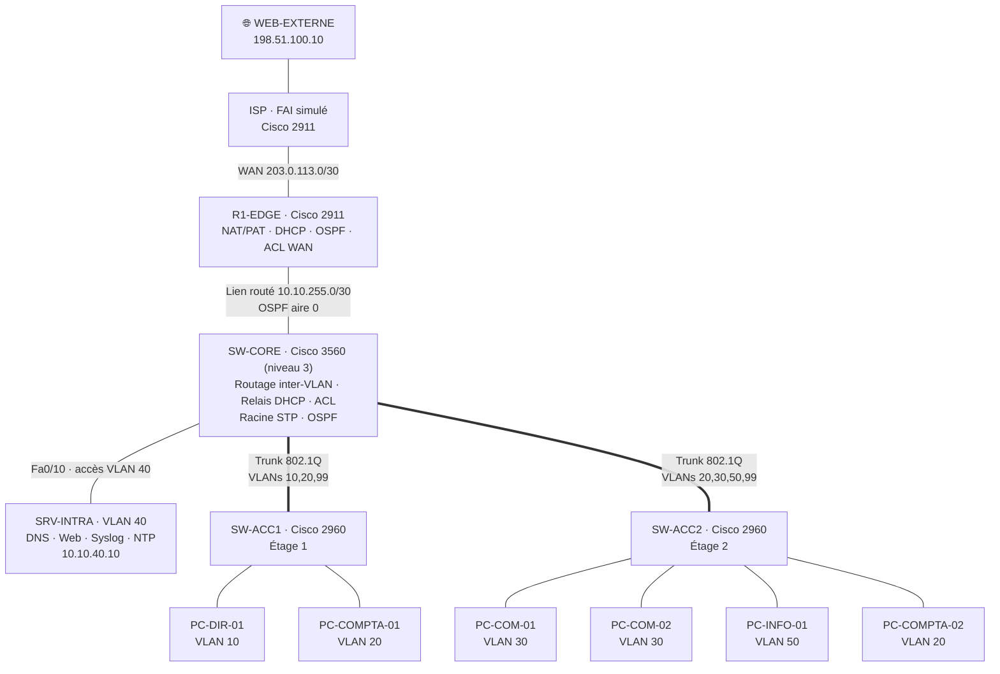

# 2. Architecture

## Schéma logique

## Modèle en deux niveaux (cœur réduit / accès)

| Niveau | Équipement | Rôle |
|--------|------------|------|
| **Bordure** | R1-EDGE | Seule porte vers Internet : NAT, filtrage des entrées, DHCP |
| **Cœur / distribution** | SW-CORE | Passerelle de tous les VLANs, routage inter-VLAN, filtrage interne, racine Spanning Tree |
| **Accès** | SW-ACC1, SW-ACC2 | Raccordement des postes, sécurité de niveau 2 au plus près de l'utilisateur |

Pour une PME d'un seul site, fusionner le cœur et la distribution dans un seul switch (*collapsed core*) est le compromis classique entre coût et performance. Ajouter un étage revient à brancher un nouveau switch d'accès en trunk sur SW-CORE.

## Choix techniques justifiés

### Routage inter-VLAN par switch de niveau 3 plutôt que « router-on-a-stick »

Avec un *router-on-a-stick*, tout le trafic entre VLANs remonte au routeur par un seul câble, qui devient un goulot d'étranglement. Le 3560 route en matériel à la vitesse de ses ports et garde le routeur pour son vrai rôle : la sortie Internet. Les passerelles sont les interfaces virtuelles (SVI) `Vlan10`, `Vlan20`…

### Lien routé (`no switchport`) entre SW-CORE et R1-EDGE

Le lien entre le cœur et le routeur est un réseau /30 dédié et non un trunk. Le routeur ne participe ainsi à aucun VLAN : un problème de niveau 2 (boucle, tempête de broadcast) ne peut pas l'atteindre.

### OSPF plutôt que des routes statiques

Avec seulement deux routeurs, des routes statiques suffiraient. OSPF a été choisi parce que :
- R1-EDGE apprend automatiquement tout nouveau VLAN créé sur SW-CORE (pas besoin de toucher au routeur) ;
- la route par défaut est diffusée au cœur avec `default-information originate` ;
- c'est la base d'une évolution vers un deuxième site ou un lien redondant.

Les SVI sont en `passive-interface` : leurs réseaux sont annoncés, mais aucun paquet OSPF n'est envoyé vers les postes, ce qui empêche un poste malveillant de s'annoncer comme routeur.

### DHCP centralisé sur R1-EDGE avec relais

Les pools DHCP sont sur le routeur, et SW-CORE relaie les demandes avec `ip helper-address`. On centralise ainsi la gestion des adresses sur un équipement, et ce mécanisme de relais est celui utilisé en entreprise avec un serveur DHCP Windows ou Linux.

### VTP en mode transparent

VTP en mode serveur/client peut effacer la base VLAN de tout le réseau si un switch avec un numéro de révision plus élevé est branché. En mode transparent, chaque switch gère ses propres VLANs : un peu plus de configuration, mais aucun risque d'effacement accidentel.

### Trunks : liste de VLANs explicite et VLAN natif dédié

- Chaque trunk ne transporte que les VLANs utiles de l'étage (*pruning* manuel) : moins de broadcast, et un VLAN absent d'un étage ne peut pas y être atteint.
- Le VLAN natif est le VLAN 999, qui n'est utilisé par aucun port : cela neutralise l'attaque par double étiquetage (*VLAN hopping*).
- `switchport nonegotiate` désactive DTP : un PC ne peut pas négocier un trunk.

### Spanning Tree : Rapid PVST+ et racine forcée

SW-CORE reçoit la priorité 4096 sur tous les VLANs pour être **toujours** le pont racine. Sans ça, l'élection se ferait sur la plus petite adresse MAC, et un vieux switch pourrait devenir racine et faire passer le trafic par un chemin absurde. Rapid PVST+ converge en quelques secondes au lieu de 30 à 50 secondes.

## Flux principaux

| Flux | Chemin |
|------|--------|
| PC-DIR-01 → Internet | ACC1 → trunk → SVI Vlan10 (ACL) → routage → R1-EDGE (NAT) → ISP → WEB-EXTERNE |
| PC-COMPTA-01 → PC-COMPTA-02 | Même VLAN : ACC1 → trunk → SW-CORE (commutation niveau 2) → trunk → ACC2, sans routage |
| PC-COM-01 → intranet | ACC2 → SVI Vlan30 (ACL) → routage → SVI Vlan40 → SRV-INTRA |
| Demande DHCP | Broadcast du PC → SVI (relais `ip helper-address`) → unicast vers R1-EDGE → réponse via OSPF |
| PC-INFO-01 → SSH SW-ACC1 | ACC2 → SVI Vlan50 → SVI Vlan99 → trunk → SW-ACC1 (`access-class 10`) |
